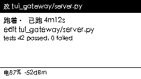
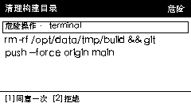
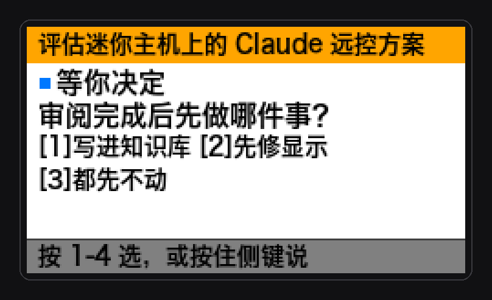

# hermes-remote

[中文](README.md) · **English**

Turn an **M5Stack Cardputer-Adv** into a **second screen and approval keypad** for an AI agent. The screen shows what the agent is doing in real time; when it needs a decision you press a key to approve or deny; hold the side button to talk and send a message.

Designed for a local network (same Wi-Fi): a Mac runs the bridge, an ESP32-S3 board acts as the terminal. No WAN remote control.

| Status | Approval | Question |
|---|---|---|
|  |  |  |

## Why

When an agent runs on your computer you are not staring at it. An approval prompt appears, nobody clicks, the task stalls. And to add a thought you have to switch back to the desktop. This board fixes both:

- **See it**: what the session is doing, which step it is on, the latest reply — a glance is enough
- **Approve it**: approvals and questions land on the board; one key decides

## Architecture

```
┌────────────┐  WebSocket (local)  ┌───────────────┐  WebSocket (LAN)  ┌───────────────┐
│ Hermes     │ ◄──── JSON-RPC ───► │ Bridge (Py)   │ ◄──── frames ───► │ Cardputer-Adv │
│ desktop    │                     │ render+gate   │ ◄──── keys ─────► │ display only  │
└────────────┘                     └───────────────┘                   └───────────────┘
```

**Frames are rendered on the Mac.** The board has no CJK fonts, so all layout, line breaking and anti-aliasing happen in Pillow, get quantised to a 4-bit palette and RLE-compressed into one frame (~6 KB). The board only decodes and blits, so fonts and layout changes never require reflashing.

## Hardware and software

- **Board**: M5Stack Cardputer-Adv (ESP32-S3, 240×135, full keyboard, microphone). First flash needs a USB-C **data** cable.
- **Mac**: Python 3.10+, `websockets` / `aiohttp` / `pillow`; optional `faster-whisper` (on Apple Silicon it uses MLX, roughly 5× faster than CPU).
- **Firmware**: PlatformIO + Arduino, deps M5Cardputer / M5Unified / WebSockets.

## Quick start

```bash
git clone https://github.com/Max-liu-1989/hermes-remote-cardputer.git
cd hermes-remote-cardputer
python3 -m venv .venv && . .venv/bin/activate
pip install -e .              # optional: pip install -e '.[stt,serial]'
```

1) **Create the device token** (shared secret between bridge and board — never commit it):

```bash
hermes-remote rotate-token        # writes ~/.hermes-remote/device.token (0600)
```

2) **Provision the board** (serial, once):

```bash
hermes-remote provision           # asks for SSID / password / bridge address / token
```

If unconfigured, the board boots an AP named `HermesRemote-XXXX`; join it and fill the same fields at `192.168.4.1`.

3) **Run the bridge** (foreground, logs visible):

```bash
hermes-remote run --rediscover
# or double-click scripts/run-bridge.command
```

The bridge discovers the local Hermes desktop backend port, attaches to the active session, and starts pushing frames.

## Keys

| Page | `1`–`4` | `fn` / `del` | `space` | `enter` |
|---|---|---|---|---|
| Status | switch session | scroll history / back to latest | reopen last reply | back to latest |
| Approval | allow once / **deny** / allow for session / always | page through full command | next pending card | — |
| Question | pick option | page text, then options | next pending card | — |
| Reply | — | page | next reply in queue | dismiss |

Hold the side button (BtnA) to talk, release to transcribe. Open-ended questions can be answered by typing on the keyboard.

**Deny is always key `2`**, never following the backend's option order — learned the hard way (pressed 2 to deny, accidentally allowed a whole class of commands for the session).

## Security model

The board can approve commands, so the trade-offs matter more than the features:

- Screen and key handling share **the same validated approval facts**; neither re-interprets raw fields
- Confirmation is bound to a specific session, request and command (`sha1(tool + command)` digest); content changes or request switches invalidate it
- When the command is missing, empty, the wrong type, or **cannot be fully paged through on the device**, the device may not approve — only deny
- High-risk actions require a second confirmation; a second confirmation never compensates for missing information
- Deny is always available; reconnects **never replay** an old approval
- The backend re-validates request validity and processing state; the device UI is not the only gate
- Device auth: the first message must be the token, compared in constant time against `?token=`; unauthenticated connections are dropped after 120 s

**Not implemented: TLS.** Frames currently travel over plain WebSocket on the LAN; the threat model assumes you trust your own Wi-Fi. Before exposing this beyond the LAN, add transport encryption and device fingerprint pinning.

## Power

The backlight dims to minimum after 45 s idle and lights up again for approvals, replies or key presses. Wi-Fi and heartbeats stay up, so approvals still arrive and beep while the screen is dark.

The board **cannot report charging state** (the official docs state `cannot read battery charging status`; forcing the read wedges the firmware), so there is no "charging" indicator.

## Tests

```bash
python -m unittest discover -s tests -p 'test_*.py'      # 120+ tests
```

Covers protocol encoding/decoding, cross-language frame cross-checks (Python encode ↔ C++ decode, pixel by pixel), the approval key model, paging and digest binding, disconnect/expiry/replay paths, the voice pipeline, and integration against a real backend (`tests/integration_real_backend.py`, requires a local Hermes backend).

## Layout

```
hermes_remote/     bridge: gateway client, renderer, approval state machine, device server, STT
firmware/          device firmware (src / include / test)
tests/             Python tests
scripts/           bridge launcher, OTA flash, preview generation, full checks
docs/              verification log, remediation notes, plan, hardening notes (real-device pitfalls)
screens/           screen samples
```

## Design notes

- **Render on the Mac, decode on the board**: layout changes need no reflash; the cost is ~6 KB per frame
- **4-bit palette** (16 colours) instead of 1-bit: colour layering saves pixels compared with more text; anti-aliased edge pixels are snapped to solid colours so small type does not blur
- **No launchd daemon**: the bridge runs in the foreground and `--rediscover` re-discovers the backend port; we deliberately avoid installing a launch daemon that could hijack startup
- 30+ real-device defects (symptom / root cause / fix) are documented in `docs/加固记录.md` (Chinese)

## License

MIT, see [LICENSE](LICENSE).
